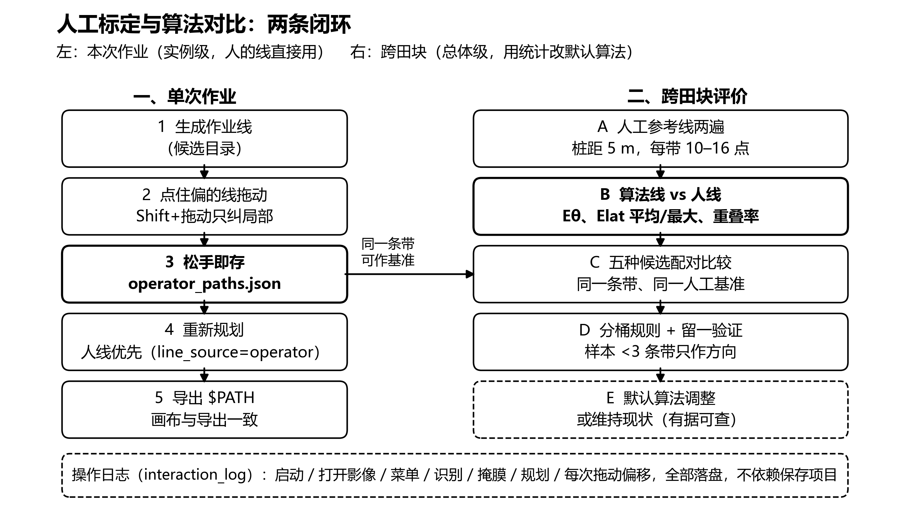
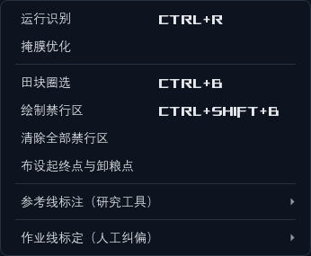
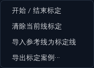

# 人工标定与算法对比说明

适用版本：ALIGN 0.4.1（2026-10-25，修订 0.4.0 的标注退出丢线问题）
对应决策：DECISION-060
文档目的：说明入口在哪、怎么操作、结果怎么读，以及在论文里如何用人工标记验证算法。



---

## 一、三分钟上手

1. 打开影像，依次完成作物识别、掩膜优化、生成作业线，并在任务清单里勾选要采用的作业线。
2. 菜单：**工具 / 作业线标定（人工纠偏）/ 开始 结束标定**。
3. 在图上点住偏掉的那条作业线，横向拖到行带中间。
   - 直接拖：整条线平移。
   - 按住 Shift 拖：只纠正拖动位置附近的一段弯曲。
4. 松手即保存，不需要点“保存项目”。画布上这条线立刻变成青色，表示“这是人线”。
5. 点“路径规划”重新规划，再导出。导出的 `$PATH` 与画布上的青色线是同一条。
6. 拖错了：右键撤销上一步；要整条恢复算法线：选中该线后点 **清除当前线标定**。

---

## 二、入口在哪里

| 功能 | 入口 | 说明 |
|---|---|---|
| 开始 / 结束标定 | 工具 / 作业线标定（人工纠偏）/ 开始 结束标定 | 进入后鼠标变成十字，可点选作业线 |
| 清除当前线标定 | 同一子菜单 | 先点选该线，再点清除；恢复算法中心线 |
| 导入参考线为标定线 | 同一子菜单 | 把“参考线标注”的桩点转成本次规划采用的人线 |
| 导出标定案例 | 同一子菜单 | 生成离线评价用的案例包 JSON |
| 参考线标注（论文真值） | 工具 / 参考线标注（研究工具）/ 第 1 遍、第 2 遍 | 用于双遍人工标注与噪声底计算 |
| 完成当前参考线（保存） | 同一子菜单 | 不想双击时，用菜单收线并保存 |
| 操作记录导出 | 设置 / 操作记录 | 打开可读的操作记录窗口，可导出副本 |

菜单截图（深色主题）：





---

## 三、两种“人线”，用途不同，不要混用

| | 作业线标定（拖动） | 参考线标注（桩点） |
|---|---|---|
| 输入方式 | 在算法线上拖动 | 沿行带逐点打桩，每 5 m 一点，每带 10 到 16 点 |
| 坐标基准 | 相对算法线 | 独立于算法线 |
| 适合做什么 | 本次作业采用、产品纠偏 | 论文精度评价、双遍重复性 |
| 是否有锚定偏差 | 有：人会不自觉以算法线为起点 | 基本没有：桩点独立于算法线 |
| 保存位置 | `<缓存>/operator_paths.json` | `<缓存>/reference_lines.json` |
| 是否影响规划 | 会，人线优先 | 不会，仅作研究证据 |

**论文的精度对比请用参考线两遍标注。** 拖动标定适合产品使用和可用性统计（多少条带需要人工干预、改多少），不适合直接当“算法误差”的真值，因为拖动带有明显的锚定效应。

---

## 四、操作细节

### 4.1 进入标定的前提

- 已导入影像；
- 已生成作业线，且任务清单里有勾选项；
- 当前不在路线编辑、测量、田块圈选等模式里。

不满足时会在日志面板给出具体原因，不会静默失败。

### 4.2 拖动规则

| 手势 | 效果 | 记录内容 |
|---|---|---|
| 左键点住线，横向拖 | 整条线平移 | `uniform` 记录，弧长为 0，偏移为拖动投影 |
| Shift + 左键拖动 | 只改拖动点附近一段，半宽约 8 m | `local` 记录，含中心弧长、偏移、sigma |
| 右键 | 撤销该线上一步 | 同时回写磁盘，画布与文件保持一致 |
| 再次点菜单项 | 退出标定模式 | 已保存的标定不受影响 |

拖动只取垂直于线方向的位移分量，沿线方向的拖动不会让线端移动。端点位置保持不变。

### 4.3 保存与失效

- 每次松手立即写盘，日志面板显示：本次偏移多少米、属于哪类纠偏（整体平移、弯曲、跳到邻带等）。
- 标定记录绑定当前掩膜算法版本和影像文件时间，二者任一变化，旧标定自动失效。
- 失效后规划会明确提示“人工标定线已失效，本次使用算法中心线”，不会偷偷套用旧线。

### 4.4 状态与来源

- 画布：青色线是人线，绿色线是算法线。
- 作业线目录：`line_source = operator` 表示该条采用人线。
- 规划报告：`operator_centerline_application` 记录应用了哪几条、有没有没匹配上的记录。

---

### 4.5 参考线标注的保存与恢复（0.4.1）

0.4.0 有个缺陷：画完桩点直接点菜单退出，线会被清空。现在改为：

- 每加一个桩点立即写草稿（`reference_draft_p1.json` 或 `p2.json`），不依赖最后按什么键；
- 双击最后一个点、或点菜单“完成当前参考线（保存）”，写入正式文件 `reference_lines.json` 并清掉草稿；
- 再次点同一遍退出、切到另一遍、进入作业线标定、关闭软件再打开，都不会丢：2 点以上自动保存，只有 1 点会提示“未保存”并记录；
- 重新进入同一遍时，自动恢复未完成的草稿，接着画；
- 只有右键“取消当前线”才会主动丢弃，并写一条 `reference.cancel` 记录。

## 五、数据落在哪里

| 文件 | 位置 | 内容 |
|---|---|---|
| `operator_paths.json` | 项目缓存目录 | 人线折线、基准线、拖动记录、偏移剖面、版本指纹 |
| `reference_lines.json` | 项目缓存目录 | 两遍人工桩点与直线拟合 |
| `reference_draft_p1.json` / `p2.json` | 项目缓存目录 | 未完成参考线的逐点草稿，收线后自动删除 |
| `calibration/<案例>.json` | 项目缓存目录下的 `calibration` 子目录 | 离线评价案例包（带几何 + 人线 + 掩膜路径） |
| `actions-<会话>.jsonl` | `%LOCALAPPDATA%\ALIGN\logs\actions` | 本次会话的全部操作记录 |

这些文件都不进项目状态与撤销历史，删掉等价于放弃对应的人工记录，不会破坏算法结果。

---

## 六、结果怎么看

### 6.1 界面上

| 位置 | 看到什么 | 含义 |
|---|---|---|
| 日志面板 | “已更新 中心线 7（replaced）：本次偏移 +0.12 m，整条线基本是同一个横向偏移” | 保存成功，偏移量与类型 |
| 状态条 | 作业线标定：拖动整条平移…… | 当前模式与手势提示 |
| 画布 | 青色线覆盖在绿色线上 | 该条已采用人线 |
| 规划日志 | 人工标定线已失效…… | 版本或影像变了，需要重标 |
| 设置 / 操作记录 | 时间、动作、目标、参数，可导出副本 | 复现问题时查“用户到底做了什么” |

### 6.2 离线报告

命令：

```bash
python src/centerline_calibration.py --case <案例.json> --out <输出目录>
```

产出 `calibration_report.json` 与 `calibration_report.md`，核心三张表：

1. **候选对比**：`current`（当前算法）、`pre_recenter`（重压前）、`mask_run_mid`（掩膜横截中点）、`distance_ridge`（距离变换脊线）、`contour_chord_mid`（轮廓弦中点），逐带算 Eθ 与 Elat，给出中位与均值、最优次数。
2. **分桶规则**：按带类型和宽度是否异常分组，推荐候选并给留一命中率。样本少于 3 条带的分桶只作方向，不作结论。
3. **逐带明细**：每条带的当前误差、最优候选、纠偏类型。

### 6.3 纠偏类型说明

| 类型 | 含义 | 该怎么处理 |
|---|---|---|
| `centered` | 人线几乎与算法线重合 | 不用改 |
| `uniform` | 整条线同一个横向偏移 | 平移可解，可考虑全局偏置修正 |
| `bow` | 偏移沿弧长平滑变化 | 带本身弯，或全局直线趋势没去干净 |
| `step` | 偏移中途换挡 | 同一条带被切断或并进了邻带，属分割问题 |
| `off_band` | 整体偏到另一条带上 | 分割问题，继续挪线只会压到别的稻行 |

`step` 与 `off_band` 不计入“中心线精度”统计，否则会把分割错误算到取中心算法头上。

---

## 七、本次交付的验收结果

这些是机制验收，不是精度结论。精度结论必须等人工标注集建立后才能给。

| 验收项 | 方法 | 结果 |
|---|---|---|
| 全量回归 | 项目 pytest | 820 passed / 1 skipped |
| 标注退出不丢线 | 画 3 个桩点后直接点菜单退出 | 自动保存 1 条 3 点参考线；重开软件可恢复未完成草稿 |
| 真实规划闭环 | 缓存 `1271b2abf0d7`，5.27 田 5 三模式 12 m，标定一条带偏移 0.12 m | 9 条作业段中只有 1 条移动 0.120 m，其余 8 条逐点一致 |
| 坐标换算 | 真实目录 + 非零掩膜偏移下拖动 | 正确选中该线，偏移记录与拖动量一致 |
| 安装包 | `build_windows.bat` | align.exe 0.4.1，自检通过 |

---

## 八、在论文里怎么用

### 8.1 能证明什么，不能证明什么

能证明：

- 算法线与人工线的一致性（方向、横向偏差、覆盖）；
- 算法误差是否落在人工判读噪声底以内；
- 不同中心线策略在同一人工基准上的相对优劣；
- 需要人工干预的带宽比例，以及干预量的分布。

不能证明：

- 人工线是绝对真值。人也会偏，所以必须两遍标注给噪声底；
- 用同一批数据调完参数再报这批数据的精度。必须有留出田块或至少留一验证；
- 把 `off_band`、`step` 这类分割错误算进中心线精度。

### 8.2 建议的标注协议

1. 覆盖至少 3 块田、2 个生育期、2 个飞行高度；每块田选 10 到 15 条宽行带。
2. 同一人标注两遍，间隔不少于 30 分钟，第二遍不看第一遍结果。工具里“第 1 遍 / 第 2 遍”分开保存。
3. 桩距 5 m，每带 10 到 16 个点，端点尽量落在田头边界内。
4. 标注完成后导出参考线 JSON，跑 `src/centerline_evaluation.py`，得到逐线指标与噪声底。

### 8.3 指标定义（与系统实现一致）

- **Eθ**：人工线与算法线的最小二乘方向角之差，180° 取小，单位度。
- **Elat**：沿人工线每 1 m 等间隔采样，各采样点到算法折线的最短距离；报平均值与最大值，单位 cm。
- **重叠率**：算法线在人工线纵向范围内的覆盖比例，用来发现截断。
- **噪声底**：两遍人工线之间同口径的偏差，作为“人眼判读能做到多准”的参照。

### 8.4 可靠性分三层写

| 层次 | 比较对象 | 说明 | 建议图表 |
|---|---|---|---|
| 重复性 | 人工第 1 遍 vs 第 2 遍 | 判读噪声底 | Bland–Altman 或差值直方图 |
| 准确性 | 算法线 vs 人工两遍均值 | 算法误差绝对值 | 逐带 Elat 箱线图、条形图 |
| 一致性 | 算法误差 vs 噪声底 | 算法是否落在人工可分辨范围内 | 同一张箱线图并排，或差值分布 |

### 8.5 候选对比与消融

在同一人工集上，把五种候选逐带配对比较：

- 统计检验：配对 Wilcoxon 符号秩，报中位数与四分位距，不报“平均提升百分比”这种容易被极端带拉偏的数；
- 报告每带最优次数与分桶结果；
- 留一验证：用其余带选出的候选，在该带上的误差是否不超过该带最优值加 1 cm。

这一节回答的正是“算法生成标记与人工标记差多少、哪种策略更接近人的判断”。

### 8.6 可以写进论文的句式（示例，数字待实测）

- “在 N 块田、M 条独立双遍人工基准上，算法作业线相对人工线的横向偏差中位数为 X cm、最大值为 Y cm，人工两遍判读噪声底为 Z cm。”
- “五种候选中，轮廓弦中点在正常宽行带上的中位偏差最低，但在宽度异常带上劣于当前算法；按带宽分桶选择可将中位偏差从 A cm 降到 B cm，留一验证命中率为 C%。”
- “N 条带中有 K 条需要人工纠偏（占 P%），纠偏以整体平移为主（Q%），其次为弯曲（R%），另有 S 条属于分割错误，未计入中心线精度。”

避免写“算法精度达到 X cm”而不交代样本量、基准定义和噪声底。

### 8.7 有效性威胁（建议单独一小节）

1. 人工线不是绝对真值，存在判读噪声与锚定效应；
2. 单块田样本少，分桶规则可能不稳定；
3. 生育期、飞行高度、光照变化会改变掩膜质量，进而影响中心线；
4. 同一批数据既调参又验收会造成过拟合；
5. 分割错误与中心估计错误必须分开统计。

---

## 九、和“王者荣耀热区分析”的异同

相同点：都是用人的真实行为反推默认配置，把“手感”变成可统计的量；都分“个体即时适配”和“群体默认优化”两层。

不同点：

| 维度 | 游戏按键热区 | 本项目人工标定 |
|---|---|---|
| 样本量 | 百万级玩家行为 | 单块田 10 到 15 条带 |
| 调整对象 | 固定 UI 布局 | 每条带的几何线，且受履带、田界、转弯半径约束 |
| 人的输入性质 | 偏好，没有唯一正确答案 | 意图，有可验证的几何对错 |
| 验证方式 | 在线 A/B、留存率 | 离线留出田块、双遍标注噪声底 |
| 失败代价 | 手感差 | 压苗、漏割、无法执行 |

所以这里借鉴的是“闭环思想”，不能照搬“用海量行为数据自动调参”。本项目的正确做法是：少量高质量标注、可解释的分桶规则、先过安全门禁，再谈默认算法是否调整。

---

## 十、常见问题

**点不中作业线。** 点选容差约 1 m，且只对已勾选的线生效；先退出路线编辑或测量模式。

**拖完没变化。** 标定只影响下一次规划，旧路径会立即失效，需要重新点“路径规划”。

**画到一半点菜单退出，线会丢吗。** 不会（0.4.1 起）。每加一个桩点就写草稿，退出、切遍数、进标定都会自动保存 2 点以上的线；重开软件再进同一遍会恢复。只有右键“取消当前线”才会主动丢弃。

**重启后线还在吗。** 在。画布从 `operator_paths.json` 读取人线，青色；规划也用它。

**为什么提示“标定已失效”。** 重新跑了作物识别或掩膜优化，掩膜算法版本变了；需要重新标定。

**报告里带数是 0。** 案例包里的 `operator_lines` 没匹配到 `band_id`，通常是标定后重新生成过作业线。重新标定再导出。

**能不能多人标。** 当前记录里有 operator 字段，界面默认留空；论文建议同一人两遍，跨人一致性另做实验。

**标定会不会影响算法评价。** 不会。评价用 `reference_lines.json` 的双遍桩点，标定线只影响本次规划。
